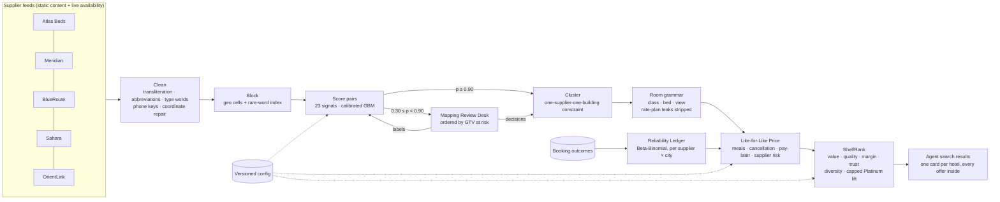

# TrueShelf architecture

## Where it sits in TBO's stack

TrueShelf has two parts with different clocks.

* **Offline (content):** identity and room mapping run when a supplier's static content changes. Matching is per city, so a
  change in one supplier's Bangkok feed only re-matches Bangkok. Output is a mapping table:
  `supplier_hotel_code → listing_id` and `supplier_room_code → canonical_room_id`.
* **Online (search time):** for each availability response, offers are joined to the mapping table, priced like-for-like and
  ranked. This is arithmetic over already-mapped data, so search latency barely changes. Booking always uses the supplier's
  original codes. TrueShelf changes what the agent sees, never what is sent to the supplier.

## Why these choices

| Decision | Reason |
|---|---|
| Rules for cleaning, a model for the match decision | Rules are cheap, testable and explainable. Learning is used only where rules run out (weighing 23 conflicting signals). |
| Calibrated probabilities, two thresholds | A probability means the same thing in every city, so "merge at 0.90, review from 0.30" is a business policy, not a magic score. |
| One-supplier-one-building constraint | It stops chain-reaction merges of sister properties without any extra model. |
| Rate-plan words stripped from room names | Otherwise "Deluxe King – Breakfast Included" becomes a fake new room and breakfast is counted twice. |
| Unreadable names stay isolated | Missing a merge costs a duplicate card. A wrong merge sells the wrong bed and costs a re-accommodation. |
| Like-for-like as a comparison price | Agents keep seeing what they will pay. L4L only reorders choices and explains the difference. |
| Empirical-Bayes reliability | Fourteen lucky bookings must not earn a perfect grade. |
| Platinum lift capped and shown | A commercial lever stays possible without hiding a better deal from the agent. |

## Extending

* **New supplier:** add its content to the feed loader. The matcher needs no change. If its room names use a new vocabulary,
  unreadable names go to mapping (fail-safe) until grammar entries are added.
* **New assumption values:** edit `config.py` (versioned), or use the live sliders to explore first.
* **Learning-to-rank (Round 2):** replace ShelfRank's fixed weights with weights fitted on TBO click and booking logs. The
  feature set (value, quality, margin, trust) stays the same.
